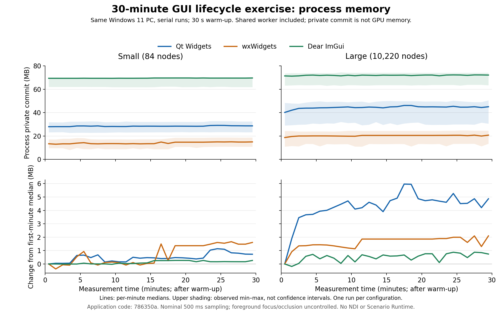

# GUI比較の実測記録

対象は **Qt Widgets、wxWidgets、Dear ImGui**。3候補とも共通GUIを実装し、クリーンWindows CIでReleaseビルド、CTest、配布ZIP展開後の起動に成功した。採用候補は未決定。保守性・機能充足を優先し、容量は補助情報とする。NDIと実Scenario Runtimeは全候補から除外し、完全移植版の容量は推定しない。

PR #152の最小Qtアプリと今回の共通GUIは別の検証対象。[PR #153](https://github.com/Nanahuse/DivergenceSplitter/pull/153) は #152 のブランチをbaseとするdraftで、mainへはマージしていない。

**最新の性能測定は[180秒×3回の再測定レポート](performance-180s-3.md)**。2026-10-24にMonitor・Diagnosticsを両データ規模・3候補の計36ケースで完了した。[集計JSON](performance-180s-3.json)と[生データ](measurements-180s-3/)を別保存し、以下の旧測定42ケースと30分試験は履歴として保持する。

## 実装と維持する責任

全候補で同じ標準C++23のmock・設定検証・画像処理・操作シナリオを使う。84ノードと10,220ノード、1280×720 RGBA入力、160×90参照画像。workerはGUIを呼ばず、immutable snapshotとlatest-only画像を共有する。構造変更コマンドは最大32件。UIは所有するタイマー／ループで取り込み、終了時はworkerをjoinする。

| 対象 | Qt Widgets | wxWidgets | Dear ImGui |
| --- | --- | --- | --- |
| Diagnostics | QTreeView / QStandardItemModel、安定ID→item対応 | wxTreeListCtrl、安定ID→item対応 | TreeNodeEx / Table、親→子対応と安定ID |
| 値更新 | 可視行のdataを変更、階層は再生成しない | 展開された枝のitem textを変更 | snapshotを周期更新して宣言、構造対応は変更時に構築 |
| 展開・スクロール | viewが保持 | DataViewが保持 | ImGui StateStorageとアプリ側の展開要求 |
| 参照画像 | QObject親子所有とQPixmap、展開時に作成してcollapse/非表示/削除で解放 | wxWindow親子所有とwxBitmap、同じ時点で解放 | D3D11 texture/SRVのComPtr、wanted集合による解放 |
| Profile | QTableWidget、signals、form同期中の再入抑制 | wxGrid、cell events、form同期中の再入抑制 | InputText / InputInt / Checkboxでdraftを直接編集 |
| ダイアログ | QFileDialog / QMessageBox | wxFileDialog / wxMessageDialog | IFileOpenDialog / MessageBox、COM寿命の管理 |
| イベントループ・描画 | QApplication / Widgets | wxApp / MSW | Win32 message loop、D3D11 device/swapchain、resize、texture、DPIの接続 |
| 独自の管理 | Window、ID/item・参照画像対応表 | Window、IdData、公開DataView APIへの接続 | Window、Texture、入力注入用Input、展開/画像/入力対応表 |

Qt/wxはGUI部品の所有権と破棄をframeworkへ任せられるが、安定ID、構造の差分削除、参照画像とform同期の管理はアプリ側に必要だった。ImGuiはdraftを直接編集でき、formと別の値を二重に保持する必要が少ない。一方、描画・OSダイアログ・入力接続を含め、アプリが維持する基盤の範囲が広い。公式Win32/DX11 backendを使い、独自描画エンジンは作っていない。

wxTreeListCtrlはcollapseイベントを直接公開しないため、公開GetView/DataView APIでcollapseを受けてCallAfterで画像を解放する。スクロール取得にもGetViewStartを使う。この接続は更新時の確認箇所となる。各候補へ独自の汎用controlライブラリは追加していない。

参照画像要求はUIが保持する階層snapshotに対して検証する。workerがDetectorを削除した直後も旧snapshotの寿命を保ち、次の構造同期で画像を解放する。この所有権の問題と修正は共通層にまとめ、候補固有の処理差にしなかった。

### 実装量の読み方

runtime C++の測定版は `786350a`。各 `main.cpp` の物理行数は空行・include・アプリ内の自動操作も含む。生成コード、vcpkg本体、公式backend、共通層は含めない。

| 候補 | main.cpp全体 | うちprobe/performの範囲 | 追加の維持責任 |
| --- | ---: | ---: | --- |
| Qt Widgets | 376行 | 66行 | item/IDの差分同期、form signalの抑制、画像所有 |
| wxWidgets | 339行 | 60行 | DataViewイベント接続、grid同期、起動時テーマ指定 |
| Dear ImGui | 375行 | 40行 | renderer/OS資源、COM、独自の入力注入・項目座標管理 |

ImGuiの入力注入はprobe/perform以外にもあり、この列を引いた値を「純粋なUI実装量」とは扱わない。行数の短さだけでは、維持する責任やテストの容易さを比較できない。

## 共通仕様の実装結果と自動試験

3候補ともローカルとWindows CIでCTest 6件に成功した。共通mock契約1件、小規模・大量GUI契約2件、Diagnosticsと暗色Profileの起動/画面保存2件、長押し途中の終了1件。配布フォルダーの小規模契約と、ZIPを新規展開した大量契約も、開発用PATHを除いて成功した。各GUI契約は13チェック。配布・集計・計測ツールの32件はWindows CIで成功した。

| 要件 | 確認した内容 | 残る範囲 |
| --- | --- | --- |
| Monitor / Preview | 状態と複数カード、latest-only画像、生成と取込sequence | 画面への実present、物理操作への応答遅延 |
| Diagnostics | 両データ規模の階層、値更新中の展開と非ゼロの数値スクロール位置の保持 | 安定IDによるスクロールアンカーの照合、削除時の代替アンカー |
| 構造変更・画像 | 生存Detectorの展開保持、展開中の別Detector削除時の画像解放、collapse/画面離脱時の解放 | 画面再表示時の展開・スクロール復元 |
| 非表示時 | 階層構築カウンターが増えず、参照画像が残らない | 実製品のデータ量・更新分布 |
| Profile | draft/Apply分離、Scenario追加/削除、入力ソース、失敗Applyの非反映、enabledの反映 | GUIでの全入力組合せ |
| 入力検証 | 共通層は空名・重複名・port範囲、GUI契約は空名を拒否 | 全エラーの実入力試験 |
| ダイアログ | 実ファイル選択と未保存確認の取消、draft保持 | ファイル選択の確定、確認ダイアログの続行を物理入力で操作 |
| Reset / 破棄 | 2秒で1回、取消、途中終了で非発火、参照画像表示中の終了 | 物理入力・フォーカス切替を伴う連続操作 |
| worker寿命 | 共通テストで20回のstart/join | 実映像入力・NDIの停止寿命 |
| 表示 | リサイズhandler、明色Diagnosticsと暗色Profileの画面保存 | 100/150/200%の実モニター移動、1920×1080の実画面、IME |

自動操作は各候補の実control API・イベント・ImGui公開IOを使うアプリ内試験で、backendだけを呼ぶ試験とは区別する。物理マウス/キーボード、IME、positive file selectionは未検証。ImGuiは既定フォントで英語mockを表示しており、日本語glyphのフォント導入も追加作業として残る。GUI契約の成功を製品全体の操作性の合格とはしない。

**wxWidgetsの実行中のnativeテーマ切替は未達。** [固定版3.3.1の実装](https://raw.githubusercontent.com/wxWidgets/wxWidgets/v3.3.1/src/msw/darkmode.cpp) は、既存top-level windowがある場合にSetAppearanceからCannotChangeを返す。戻り値を確認して「Theme: restart required」と表示する。全候補の `--dark` による起動時の暗色表示は確認した。wxで再起動と設定引継ぎ、または独自配色を行う場合は、その実装・維持コストを別途評価する。`U01_theme_resize_handlers` はhandler実行のチェックであり、この未達を合格に変えるものではない。

CI保存画面：Diagnostics [Qt](captures/qt-diagnostics.png) / [wx](captures/wx-diagnostics.png) / [ImGui](captures/imgui-diagnostics.png)、暗色Profile [Qt](captures/qt-profile.png) / [wx](captures/wx-profile.png) / [ImGui](captures/imgui-profile.png)。画面保存はDPI試験の代用にはしない。

## 同じ小変更による保守性の確認

初版 `9a96bf7` から「Scenario.enabledをdraft/Apply、Monitor、Diagnostics、未保存確認へ追加」を [独立したcommit `7d91470`](https://github.com/Nanahuse/DivergenceSplitter/commit/7d91470) として適用した。8ファイル、89追加/27削除。共通層とテストは全候補で共有する。

| アプリ固有UI | 追加 | 削除 | 変更箇所 |
| --- | ---: | ---: | --- |
| Qt Widgets | 9行 | 6行 | checkbox列、itemChanged、form同期、カード・値表示、操作driver |
| wxWidgets | 21行 | 8行 | bool列、cell event、form同期、カード・値表示、操作driver |
| Dear ImGui | 7行 | 6行 | checkbox列、カード・値表示、公開IO操作driver |

wxの差分には整形と終了時reportの例外処理も含まれ、変更量の純粋な順位には使えない。共通層では無効Scenarioのactive/connected抑制、動的追加ノードへの継承が必要だった。失敗Applyの漏出、旧snapshotの不変性、安定ID、他Scenarioへの非波及、discard、新規Scenarioの既定値を共通テストで確認した。実GUIではenabledだけを変えた未保存確認の取消後にもdraftが残ることを確認した。

一つの変更では長期保守性を断定できない。ただし、Qt/wxではformとdraftの同期箇所へ変更が分散し、ImGuiではdraftを直接変更する箇所で済んだこと、ImGuiに描画・OS資源管理の独立した責任が残ることは、この試作から確認できる。

## Windows CIと再現手順

[配布測定run](https://github.com/Nanahuse/DivergenceSplitter/actions/runs/39964806286) はsource `3ba38b2`、[全候補キャッシュ利用run](https://github.com/Nanahuse/DivergenceSplitter/actions/runs/39982972327) は `6b389cc`。この間のruntime C++変更はない。Pythonツール・CIだけを変更した。固定情報、時刻、バイト数、差分、Artifact IDは [CI記録JSON](ci-distribution.json)。

| 候補 | キャッシュなしvcpkg install実時間 | 同ジョブ全体 | キャッシュ利用ジョブ全体 | 復元package数 |
| --- | ---: | ---: | ---: | ---: |
| Qt Widgets | 104分51秒 | 107分32秒 | 3分11秒 | 37 |
| wxWidgets | 47分44秒 | 50分18秒 | 3分01秒 | 22 |
| Dear ImGui | 47分52秒 | 50分42秒 | 2分39秒 | 16 |

vcpkg install実時間はログの開始/完了時刻差で、依存の取得・ビルド・配置を含む。ジョブ全体はsetup、テスト、配布、uploadも含む。Qt/ImGuiのcold実績は先行run `39949952919` / source `052b7cb`（当時のCTestは3件・GUI契約12チェック）。依存baseline/manifestは同じだが、最新の6件のcold実行と偽らない。wxのcold実績は6件の成功run。各candidateは別runnerなので、これらの所要時間からGUI性能を順位付けしない。

固定baseline `9e593bb18ea69cc5095e012465dcd675a822ed0d`、OpenCV `4.12.0#7[contrib]` defaults、qtbase `6.11.1#1`、wxwidgets `3.3.1#1`、imgui `1.92.8#1[win32-binding,dx11-binding]`。Windows Server 2025 hosted image `20261021.278.1`、MSVC `19.51.36260.0`、tools `14.51.36231`、SDK `10.0.26100.0`、CMake `4.3.1-msvc1`、Ninja `1.13.2`。ローカルcompilerは `19.51.36252.0`。開発環境とCIでmanifestを照合する。

Developer PowerShellで固定vcpkgを `VCPKG_ROOT` に指定し、`tools/build_gui_comparison.ps1 -Candidate qt`、`wx`、`imgui` を実行する。helperはReleaseビルド、6 CTests、CMake install/Qt deploy、DLL・通知検証、ZIP生成、別フォルダーへの展開後起動をまとめる。出力先を上書きせず新規に用意する。詳細は [README](../README.md)。

### 発見した問題と修正

- 初回wx CIは依存構築後、固定時間だけ待った大量ノードのscroll試験で失敗した。実際に非ゼロ位置へscrollできるまで待つ方式へ修正し、その後の6 CTestsで位置・展開保持も成功した。要件は緩めていない。
- この失敗で依存cacheも失われたため、actions/cacheのrestore/saveを明示した。依存configureが完了した場合は、後続のGUI試験が失敗しても完全な依存cacheを保存する。依存構築途中のcacheは保存しない。wxでcold→cache復元を実測した。
- 日本語MSVCの接頭辞の文字化けでローカルのNinjaヘッダー依存が0件となり、古いobjectとのABI不整合を検出した。helperへコードページ65001、fresh configure、clean buildを適用し、Qt adapterの依存265件と全契約を再確認した。GUI候補共通のツールチェーン問題として扱う。
- ImGuiの期限更新で遅延が累積し、wxTimerの67ms指定も約12.6Hzになった。位相を保って遅れた期限を捨てる共通PreviewCadenceと、wxの16ms native heartbeatで15Hzへ揃えた。独自timer threadは追加していない。調整前の測定は比較から除外した。
- 計測runnerの再開テストでLinuxのplatform照会までmockしたことによる失敗を検出した。OS照会を独立させて修正し、通常CIも成功した。測定アプリの変更はない。

## 旧測定：同一Windowsマシンでの性能測定

全42ケースは2026-10-23 19:11:26 UTCに完了した。Monitorは30秒warmup + 120秒測定を5回、両データ規模・全候補で直列実行した。試行ごとに候補順を反転。測定source `0d2adee` のruntimeは `786350a` と同一。Windows 11 `10.0.26200`、AMD64 Family25 Model116、12 logical CPUs、Balanced電源。通常のデスクトップ活動、ウィンドウの前景・遮蔽は統制・記録していない。shared workerのCPUを含み、GUI単独の負荷ではない。

| 候補・規模 | CPU中央値（1論理core=100%） | 入力Hz中央値 | GUI取込Hz中央値 | 最大sampled private MB | 取込時frame age p95の中央値 ms |
| --- | ---: | ---: | ---: | ---: | ---: |
| Qt small | 19.72% | 59.99 | 14.92 | 31.26 | 19.68 |
| Qt large | 22.54% | 59.99 | 14.92 | 32.52 | 19.62 |
| wx small | 35.41% | 59.49 | 15.00 | 17.52 | 36.05 |
| wx large | 42.23% | 59.29 | 15.00 | 19.26 | 37.25 |
| ImGui small | 20.75% | 59.28 | 15.00 | 69.08 | 26.95 |
| ImGui large | 21.24% | 59.29 | 15.00 | 66.52 | 26.64 |

MBは1,000,000 bytes。CPUはCPU秒/実測秒で、12 coreで割ったPC全体の使用率ではない。private/working setは約500ms間隔のsample最大で、OSの厳密な瞬間peakやGPUメモリではない。p95は各runのp95を5回の中央値にした値。取込はscanout/presentや物理入力応答ではない。起動時のプロセス生成→初回取込の中央値は、small/largeの順でQt 145/143ms、wx 125/140ms、ImGui 126/123ms。Diagnosticsだけのrunでは測定中の取込なしを0msと誤表示せず、N/Aにする。

入力の60Hzは目標周期であり、全試行で厳密に60Hzを達成したわけではない。10試行の範囲はQt 59.98–60.00Hz、wx 55.74–59.92Hz、ImGui 55.19–59.83Hz。一部試行での低下原因は切り分けていない。GUI取込は約15Hzで進行したが、この試作と環境の結果をライブラリ固有の性能順位にはしない。

### Diagnosticsの定常計測

各30秒warmup + 120秒を1回。測定中は階層を維持してスコアを更新し、最初のDetectorを展開した。全6ケースでwarmup後の階層再構築は0回だった。

| 候補・規模 | CPU（1論理core=100%） | 最大sampled private MB | 値更新周期 Hz | 参照要求の累計 |
| --- | ---: | ---: | ---: | ---: |
| Qt small | 11.91% | 20.68 | 14.92 | 1 |
| Qt large | 15.06% | 34.20 | 14.91 | 1 |
| wx small | 31.87% | 16.06 | 15.00 | 2 |
| wx large | 41.37% | 21.36 | 14.99 | 1 |
| ImGui small | 17.72% | 62.86 | 15.00 | 1 |
| ImGui large | 17.72% | 62.05 | 15.00 | 1 |

参照要求はwarmupを含む累計。wx smallの追加1回は発生時点・原因を特定できていないため、全ケースで1回だけだったとは扱わない。別のGUI契約では、値更新中の参照再生成がないことを確認している。状態更新の通知→表示遅延そのものは未測定。

### 30分の切替・構造変更・画像解放

各ケースは30秒warmupの後に1800秒測定。Diagnostics展開/構造変更/collapse、Monitor、pause、Profile、再開の8操作を繰り返した。pause/resumeは処理状態の切替であり、共通テストの20回のworker thread start/joinとは別。全6ケースで終了コード0、error空、非表示時の参照画像残留エラーなし。操作数はwarmupを含む。

| 候補・規模 | 操作ステップ | 参照要求 | 最大sampled private MB | 最初→最後の1分中央値差 MB |
| --- | ---: | ---: | ---: | ---: |
| Qt small | 6,828 | 854 | 32.797 | +0.727 |
| Qt large | 6,828 | 854 | 50.545 | +4.868 |
| wx small | 6,913 | 864 | 18.735 | +1.608 |
| wx large | 6,880 | 860 | 24.789 | +2.097 |
| ImGui small | 7,036 | 880 | 69.734 | +0.262 |
| ImGui large | 7,053 | 882 | 74.572 | +0.741 |



[SVG](memory-soak.svg)。上段は1分ごとの中央値とsample最小/最大の帯、下段は最初の1分中央値との差。帯は信頼区間ではない。Qt largeは初期に増加した後、おおむね44–46MBの中央値で推移した。OS/GPU handle数とheapの割当原因は測定しておらず、30分の観測だけでリークがないとは断定しない。全42ケースのmemory sample間隔の最大は約0.611秒だったが、これは入力応答の保証ではない。

反復中はpauseと画面切替があるため、1800秒全体の生成/画像取込HzをMonitorの60/15Hzと比較しない。古い画像を読み飛ばすskipped counterも、latest-onlyとして意図した挙動を含む。

### 中断・再開と生データ

最初のQt small反復試行は約3分で終了コード0のままreportを残さず終了したため、未完了として記録した。例外ログはなく原因は不明。ウィンドウを閉じた場合にも起こり得るが断定しない。runnerへreport有無・測定時間の検証と、binary SHA256/環境/設定を照合する再開機能を追加した。完了済み31ケースを再検証して保持し、未完了ケースを同じ配布exeで再試行した。早期終了は再現しなかったが、原因解決済みとは扱わない。

終了後、全候補の配布全ファイル（Qt 137、wx 77、ImGui 62ファイル）とZIPを保存済みのSHA256と再照合し、一致した。計測中だけのスリープ・表示オフ抑制要求も終了時に解除した。[再開と検証記録](measurement-notes.json)、[42件の生JSONと実行環境](measurements/)、[全run・1分集計の要約](local-performance.json) を残す。先行の校正用測定、pytestの並行負荷が混入した無効測定は、このデータセットへ混ぜていない。

生データから集計を再現できる。新しい出力先を使う。

```powershell
uv run python tools/summarize_gui_comparison.py --source experiments/gui-comparison/results/measurements --output build/gui-performance-regenerated.json
```

測定をやり直す場合は、再ビルド後に新しいフォルダーで `uv run python tools/run_gui_comparison.py --output build/gui-measurements-new` を使う。既定で30秒warmup、120秒×5回、両規模のDiagnostics各1回、1800秒反復各1回。中断後は同じコマンドへ `--resume` を付ける。バイナリ・電源等の条件が変わった場合は再開を拒否する。GUIを閉じてreportがなければ終了コード0でも成功にはしない。

## 配布容量（選定での重要度は低）

以下は全て実測。CIの内側ZIPのサイズ・SHA256・展開後合計は、取得したArtifactの中身から再照合した。全候補でPython `3.14.6`、DEFLATE level6、順序・日時正規化、zlib `1.3.1.zlib-ng`。外側Artifactはupload-artifactのcompression-level0で、配布ZIP・画面・ログ・レポートを含むため別の値となる。

| 候補 | CI展開後 bytes | CI配布ZIP bytes | CI外側Artifact bytes | ローカル展開後 bytes | ローカル配布ZIP bytes |
| --- | ---: | ---: | ---: | ---: | ---: |
| Qt Widgets | 107,448,895 | 44,254,925 | 44,629,050 | 107,513,348 | 44,273,201 |
| wxWidgets | 25,693,919 | 9,213,144 | 9,564,891 | 25,706,636 | 9,215,371 |
| Dear ImGui | 14,700,278 | 5,485,845 | 5,903,957 | 14,703,267 | 5,486,109 |

Qtはicudt78.dll 33,110,528 bytes、dxcompiler.dll 14,261,192 bytes、Qt6Gui.dll 6,998,016 bytesが大きい。wxはcore DLL 7,547,392 bytes、OpenCV imgproc 4,512,256 bytes、core 3,057,152 bytes。ImGuiはOpenCVの同2 DLLが大きく、公式backendを含むstatic GUI分は本体exe 628,224 bytesへ計上する。GUI DLLがないことをGUI容量0とは扱わない。

同じruntime sourceのローカルとCIの差は展開後でQt −64,453、wx −12,717、ImGui −2,989 bytes。Qtのうち−61,976 bytesはSDK graphics redistributablesの差、OpenCV2 DLLは各候補−3,072 bytes。wx DLLは計−9,728 bytes。通知・manifest・環境メタデータにはcheckout改行と環境文字列による計+83 bytesの差がある。同じSDKフォルダー版でも同梱DLLのhash/sizeは異なった。compiler patchと環境差を記録し、残りを特定の最適化効果とは推定しない。全ファイルのhash差はCI記録JSONに保持する。

依存分類・大きいファイルは [ローカル記録](local-distribution.json) と [CI記録](ci-distribution.json)。共有DLLは一度だけ計上。debug DLL、PDB、開発header、不要な静的libraryを配布せず、MSVC runtimeをapp-localに配置する。保守性を犠牲にした容量最適化は行っていない。

## ライセンス・残る判断

固定vcpkg checkoutから各portのcopyright/SPDX、source参照、MSVC/SDK通知を配布し、DLL所有者と通知の存在を検証する。QtはmoduleごとのLGPL等とthird-party条件、wxはwxWindows例外を含む条件、ImGuiはMIT通知を記録した。[技術条件と公式資料](../technical-feasibility.md) を参照。ImGui test engineは追加していない。通知の自動収集だけで製品配布に必要な全対応が完了したとは扱わない。

クリーンCI・ZIP配布、共通操作の自動試験、両データ規模の30分反復は3候補とも実現した。一方、実画面DPI/IME/物理操作、wxの実行中テーマ切替、スクロールアンカー、画面復元、状態更新/操作の実表示遅延が残る。Qt初回の原因不明の早期終了とwx smallの参照要求追加1回も記録した。これらを未達・未検証・原因未特定のまま示し、容量や行数だけで採用候補を決定しない。mainへのマージはユーザーの結果確認後の判断とする。
