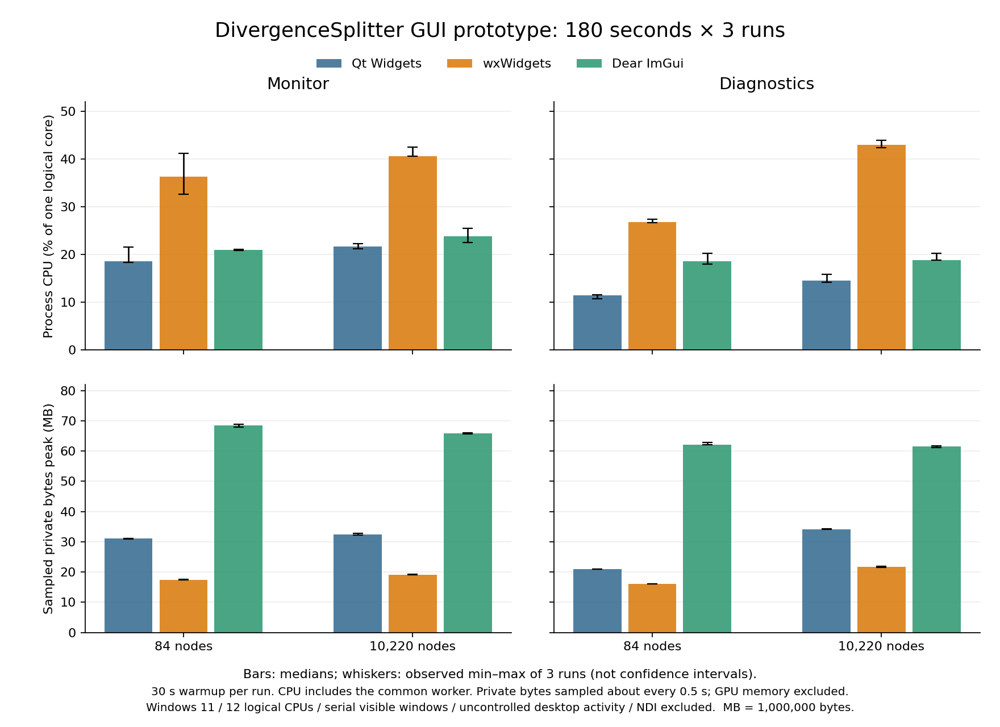

# Monitor・Diagnosticsの再測定（180秒×3回）

Qt Widgets、wxWidgets、Dear ImGuiを、84 / 10,220ノードの共通mockで各180秒×3回測定した。Monitor 18ケース、Diagnostics 18ケースの計36ケースが正常終了し、全ケースのレポート検証を通過した。各回の前に30秒warmupを置く。実測区間は179.969–180.070秒で、集計には各回の実測秒数を用いる。前回の30分切替・開始停止試験は再実施せず、[従来の42ケース](measurements/)と[比較レポート](comparison.md)を履歴として保持する。

この結果だけで採用候補は決定しない。NDIと実Scenario Runtimeは全候補に含めず、完全移植版の容量は推定しない。

## 条件と証拠

- 開始UTC: `2026-10-23T23:33:37.188900+00:00` / 完了UTC: `2026-10-24T01:39:42.759781+00:00`。
- runner source: `9e9a5a0405d36e18e03a0162d8fb12ca52488d37`、開始時のworking treeはclean。runtime C++は従来測定と同じ `786350a`。
- Windows 11 `10.0.26200`、AMD64 Family 25 Model 116、12 logical CPUs、Balanced電源。1280×720 RGBA入力、160×90参照画像。
- 同じ配布exe・DLLを使用し、終了後も全配布ファイルとZIPのサイズ・SHA256が前回記録と一致した。Qt 137 / wx 77 / ImGui 62ファイル。
- 1プロセスずつ直列実行。反復2では候補順を逆転し、反復1/3はQt→wx→ImGui。wxは常に中央のため完全な順序相殺ではない。Monitorを先に全件、その後Diagnosticsをsmall→largeで測定。
- 測定中は一時的なsystem/display実行要求を使用し、終了後に解除した。電源プランやロックポリシーは変更していない。前景・遮蔽、通常のデスクトップ活動、温度・クロックは統制していない。
- [36件の生データと環境情報](measurements-180s-3/) / [集計JSON](performance-180s-3.json) / [検証・制約の記録](measurement-notes-180s-3.json)。

## CPUとメモリ

値は3回の**中央値（最小–最大）**。CPUはCPU秒÷実測秒×100で、1 logical core=100%。共通workerを含むプロセス全体であり、12 coreで割ったマシン全体の使用率ではない。private / working setは各回で約500ms間隔に観測した最大値を3回集計したもの。MB=1,000,000 bytes。OSの瞬間peakやGPUメモリではない。

| 画面 | ノード数 | 候補 | CPU % | sampled private peak MB | sampled working set peak MB |
| --- | ---: | --- | ---: | ---: | ---: |
| Monitor | 84 | Qt Widgets | 18.60 (18.35–21.54) | 31.08 (30.96–31.11) | 66.35 (66.31–66.38) |
| Monitor | 84 | wxWidgets | 36.26 (32.62–41.21) | 17.42 (17.38–17.50) | 42.04 (42.02–42.09) |
| Monitor | 84 | Dear ImGui | 20.95 (20.83–21.09) | 68.38 (67.82–68.86) | 63.05 (62.96–63.05) |
| Monitor | 10,220 | Qt Widgets | 21.71 (21.16–22.19) | 32.37 (32.22–32.80) | 67.88 (67.66–68.10) |
| Monitor | 10,220 | wxWidgets | 40.65 (40.60–42.51) | 19.15 (19.07–19.21) | 43.54 (43.52–43.60) |
| Monitor | 10,220 | Dear ImGui | 23.80 (22.47–25.49) | 65.91 (65.67–66.11) | 64.70 (64.58–64.71) |
| Diagnostics | 84 | Qt Widgets | 11.42 (10.64–11.48) | 20.91 (20.90–20.95) | 56.72 (56.69–56.80) |
| Diagnostics | 84 | wxWidgets | 26.82 (26.67–27.39) | 16.03 (16.02–16.14) | 42.89 (42.83–42.92) |
| Diagnostics | 84 | Dear ImGui | 18.51 (17.91–20.27) | 62.07 (62.00–62.85) | 60.40 (60.02–62.11) |
| Diagnostics | 10,220 | Qt Widgets | 14.51 (14.10–15.79) | 34.08 (34.05–34.34) | 69.42 (69.35–69.62) |
| Diagnostics | 10,220 | wxWidgets | 43.03 (42.39–43.89) | 21.64 (21.54–21.87) | 48.25 (48.21–48.35) |
| Diagnostics | 10,220 | Dear ImGui | 18.84 (18.81–20.18) | 61.56 (61.19–61.67) | 62.56 (62.32–63.03) |



[SVG版](performance-180s-3.svg)。棒は中央値、ひげは3回の最小–最大で、信頼区間ではない。

## Monitorの入力・プレビュー取込

以下も3回の中央値（最小–最大）。入力は60Hz、GUI取込は15Hzを要求する。p95は各回のcapture→GUI取込のp95を集計した値で、実画面へのpresent・物理操作応答ではない。起動はプロセス生成から初回取込までで、warmupの除外対象外。

| ノード数 | 候補 | 入力 Hz | GUI取込 Hz | 各回p95 ms | 起動→初回取込 ms |
| ---: | --- | ---: | ---: | ---: | ---: |
| 84 | Qt Widgets | 60.00 (60.00–60.00) | 14.92 (14.92–14.92) | 19.19 (19.16–20.16) | 137.50 (135.83–172.62) |
| 84 | wxWidgets | 59.24 (59.07–59.39) | 15.00 (15.00–15.00) | 33.34 (31.18–38.02) | 233.00 (114.32–239.45) |
| 84 | Dear ImGui | 59.63 (59.27–59.94) | 15.00 (15.00–15.00) | 21.45 (19.89–29.31) | 122.95 (109.22–123.60) |
| 10,220 | Qt Widgets | 60.00 (60.00–60.00) | 14.92 (14.92–14.92) | 19.40 (19.36–19.43) | 147.07 (139.94–147.26) |
| 10,220 | wxWidgets | 59.65 (59.62–59.70) | 15.00 (15.00–15.00) | 30.33 (30.14–30.48) | 119.81 (117.53–361.19) |
| 10,220 | Dear ImGui | 59.63 (59.16–59.72) | 15.00 (15.00–15.00) | 27.99 (21.12–28.93) | 116.75 (116.21–248.20) |

## Diagnosticsの更新と参照画像

最初のDetectorを展開し、固定階層の値更新を測る。動的追加・削除や画面切替の反復は今回の定常測定に含めない。階層再構築はwarmup後のカウンター。参照画像要求はwarmupを含むプロセス累計で、反復1 / 2 / 3の順に記載する。値更新Hzは`value_update_cycles / measurement_seconds`で、実際の表示present数ではない。

| ノード数 | 候補 | 入力 Hz | 値更新 Hz | 階層再構築 1/2/3 | 参照画像要求 1/2/3 |
| ---: | --- | ---: | ---: | --- | --- |
| 84 | Qt Widgets | 59.99 (59.99–60.00) | 14.92 (14.92–14.92) | 0 / 0 / 0 | 1 / 1 / 1 |
| 84 | wxWidgets | 59.48 (59.18–59.48) | 15.00 (15.00–15.00) | 0 / 0 / 0 | 1 / 1 / 1 |
| 84 | Dear ImGui | 59.63 (59.55–59.68) | 15.00 (15.00–15.00) | 0 / 0 / 0 | 1 / 1 / 1 |
| 10,220 | Qt Widgets | 59.99 (59.99–60.00) | 14.92 (14.92–14.92) | 0 / 0 / 0 | 1 / 1 / 1 |
| 10,220 | wxWidgets | 59.60 (59.46–59.85) | 15.00 (15.00–15.00) | 0 / 0 / 0 | 1 / 1 / 1 |
| 10,220 | Dear ImGui | 59.61 (59.56–59.73) | 15.00 (15.00–15.00) | 0 / 0 / 0 | 1 / 1 / 1 |

Diagnosticsは測定中のpreview取込がないため、取込Hzは0、frame age / 初回取込の比較値はN/Aとする。生データのframe-age 0や起動時の一時的なMonitor取込を、Diagnosticsの0ms遅延と解釈しない。参照要求の回数だけから要求時刻や再生成原因を断定しない。

## 前回との扱いと残る範囲

前回のMonitorは120秒×5回、Diagnosticsは120秒×1回で、今回とは別のデータセット。配布バイナリは同一だが、測定時間帯やデスクトップ活動を統制していないため、差をコード改善やライブラリ固有の性能差と断定しない。前回の30分試験・中断記録・メモリ推移も変更しない。今回の3分測定は長期のメモリ安定性試験の代用にはならない。

保守性・機能充足の評価は[既存比較](comparison.md)を参照。wxの実行中nativeテーマ切替、ImGuiの日本語フォント、物理入力・IME・実モニター間DPI移動、scroll anchor / 画面再表示時の復元、状態変更から表示までの遅延は今回も未解決・未測定。

## CIでの確認

再測定ツールを追加した `9e9a5a0` の[Windows GUI比較CI](https://github.com/Nanahuse/DivergenceSplitter/actions/runs/40040344288)は3候補すべて成功した。各候補の6件のCTest、35件のPythonツール試験、install先とZIP展開先のGUI契約を確認した。同コミットの通常CI・Core配布・既存Windows配布CIも成功している。これらはビルド・配布・機能検証であり、本レポートの性能値は上記の同一ローカルWindowsマシンの測定値である。

## 再現手順

固定依存のRelease配布物を用意した後、既存の結果を上書きしない新規出力先で実行する。Windowsの通常デスクトップで各アプリを終了させず、途中でバイナリを更新しない。

```powershell
.venv/Scripts/python.exe tools/run_gui_comparison.py --output build/gui-measurements-new-180s-3 --seconds 180 --repeats 3 --diagnostics-repeats 3 --soak 0
.venv/Scripts/python.exe tools/summarize_gui_comparison.py --source experiments/gui-comparison/results/measurements-180s-3 --output build/gui-performance-180s-3-regenerated.json
```

最初のコマンドは約126分（36×210秒＋起動時間）を要する。後者はこの保存済みデータの集計を再生成する。CLIの既定値は旧測定の再現用に保持しており、今回の条件は引数で明示する。
